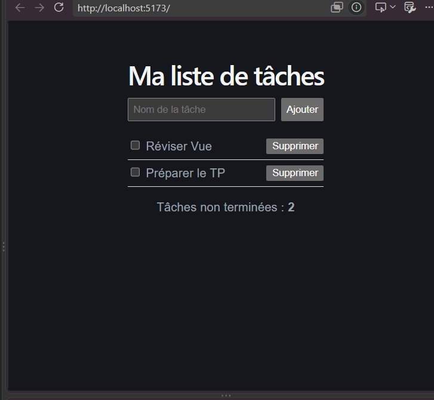
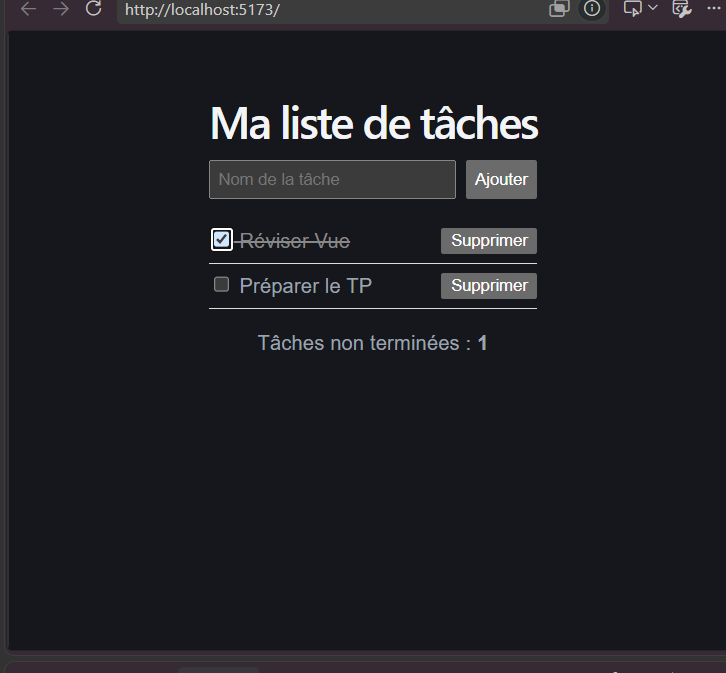

# TP Vue.js : Gestion d'une liste de tâches

Application Vue 3 (`<script setup>`) permettant d'ajouter, terminer et supprimer des tâches.

## Lancer le projet
npm install
npm run dev

## Captures

## Explications
- **v-for** parcourt le tableau réactif `taches` et affiche un élément par tâche.
- **:key** donne un identifiant unique (`tache.id`) à chaque élément, pour que Vue sache lequel a changé ou été supprimé.
- **computed** calcule le nombre de tâches non terminées et se met à jour automatiquement.